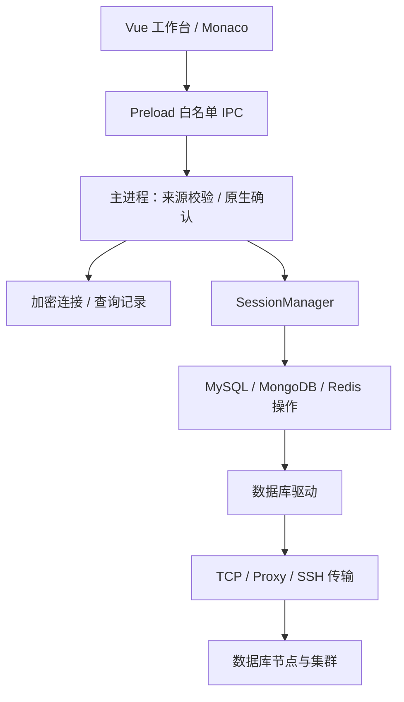

# DB EX 技术架构

## 进程与职责

DB EX 是本地优先的 Electron + Vue 3 + TypeScript 桌面应用。数据库连接、网络隧道、凭据解密和文件访问位于 Electron 主进程；Renderer 没有 Node 权限，只能调用 Preload 暴露的固定 `window.dbex` 方法。

| 模块 | 职责 |
|---|---|
| `src/main/index.ts` | Electron 生命周期、窗口安全、固定 IPC 注册、原生写入确认、文件选择/保存 |
| `src/main/connections/manager.ts` | 配置校验、驱动建立与关闭、会话只读状态、串行操作、取消/超时、资源浏览 |
| `src/main/connections/transport.ts` | TCP、SOCKS5、HTTP CONNECT、受认证本地 SOCKS 转发、socket/server 清理 |
| `src/main/connections/ssh.ts` | 逐跳主机指纹验证、密码/私钥/Agent、SSH Channel 与连接链生命周期 |
| `src/main/connections/redis-client.ts` | ioredis 传输适配、每个节点的 TLS、Sentinel 发现、Cluster 路由与重连 |
| `src/main/connections/ssh-config.ts` | 不执行 shell 的 SSH config 子集解析 |
| `src/main/connections/store.ts` / `credentials.ts` | 连接元数据、凭据脱敏/合并、显式清除、导入导出 |
| `src/main/storage/` | safeStorage 加密、串行原子写入、查询历史/收藏 |
| `src/main/operations/` | 各数据库的独立操作契约、权限校验、限量与冲突检测 |
| `src/shared/types.ts` | 明确的连接、会话、数据库操作和结果类型，无驱动依赖 |
| `src/renderer/` | 连接表单、资源树、编辑器、数据网格、导入预览、主题与布局 |

## 会话和写入模型

每个活动会话只接受一个数据库操作。SessionManager 使用 AbortController 和 30 秒上限管理当前任务，断开时释放驱动及整条传输链。取消按钮会断开当前会话；重新连接后恢复默认只读状态。异常或取消后，已经自动提交的写入不承诺回滚；用户需要核对数据库实际状态。

写入有三道控制：会话必须解锁、操作必须携带明确确认意图、主进程必须获得原生确认对话框的肯定响应。生产环境使用更明显的确认提示。数据库账号权限始终是最终权限边界。

MySQL 使用一条物理连接维持显式事务。普通只读 SQL 在服务端只读事务中运行，并通过保守语句策略拒绝多语句、可执行注释、存储函数、文件输出和会话控制。CRUD 使用 Prepared Statements、真实主键和完整旧行条件；MongoDB 使用 Canonical EJSON 和完整旧文档的字面量比较。Redis String 编辑使用固定内部单键脚本实现原值比较；其他类型通过受限原生命令修改。

## 数据流与容量

MySQL SELECT 在服务端包装 LIMIT/OFFSET；其他支持的查询以驱动事件逐行收集，在行数/字节预算耗尽时销毁连接。结果的 `rows` 供有限量显示，`rawRows` 保留可编辑标量；包含二进制值时不产生可编辑原始行。

MongoDB 游标以原始 BSON 逐文档迭代，先限制原始文档字节数，再单独解码为精确 BSON 类型；同时限制批大小、总行数、处理时间与输出字节，finally 中关闭游标。协议响应中的错误码保持普通数字，确保驱动能识别选主变化并重试读取。`documents` 是完整 Canonical EJSON，而不是从截断显示文本重构的文档。

Redis String 使用 GETRANGE 限量读取；其他集合类型使用 SCAN 或范围/游标分页。命令台不允许默认全量读取。Redis 的传输预算在协议解析之前限制异常大回复；UI 结果也有单独限制。MySQL 的结果预算位于驱动解码之后，MongoDB 也必须先接收网络批次再检查原始文档，因此不能保证遇到单个巨大协议值时的峰值内存。

导入先由用户选文件、预览，再提交受限批次。MySQL InnoDB 导入使用事务或保存点；MongoDB 多文档新增及 Redis 跨 Key 删除可能部分完成。导出只覆盖当前结果页，不是完整数据库备份。

## 拓扑与 TLS

传输层提供 `open(host, port)`，保留逻辑节点名称。MySQL 把已连接的流交给驱动，TLS 仍校验配置的数据库名称。Redis 为每个发现节点创建路由流并在最终流上执行 TLS，校验该节点证书。MongoDB 使用带临时认证的本地 SOCKS5 入口，由官方驱动继续发现副本集成员并校验各成员名称。

代理只承载到首个 SSH 节点的连接；后续 SSH 跳板和数据库地址由相应远端节点访问。全部本地监听仅绑定 `127.0.0.1`。SRV/TXT DNS 查询仍在本地进行。没有自动改写集群宣告地址。

## 本地存储与文件边界

连接配置和查询历史分别保存在 Electron userData 下的加密 JSON 容器，使用系统 safeStorage，拒绝 Linux `basic_text` 后端。写入队列保证同类并发修改不覆盖，临时文件以受限权限创建后原子重命名；配置读取有大小限制。

连接编辑返回脱敏配置及“已保存”字段标记。Renderer 留空时，只有同一端点、认证身份和用途才能继续使用已有密钥；跨主机或身份变更不自动继承。凭据清除须传入受支持字段。导出连接时删除密码、口令和完整 URI；导出仍可能包含主机名、用户名及本机路径。

## 当前工程边界

数据库驱动仍运行在主进程，尚未迁移到 Utility Process/Worker。协议解析和少量同步数据转换可能占用主进程，需用真实大值测试继续评估。当前没有连接池共享、跨会话事务、通用插件执行器、远程账户服务、云同步或遥测。发行、签名和平台兼容性以 [ROADMAP.md](ROADMAP.md) 的实际验证状态为准。
